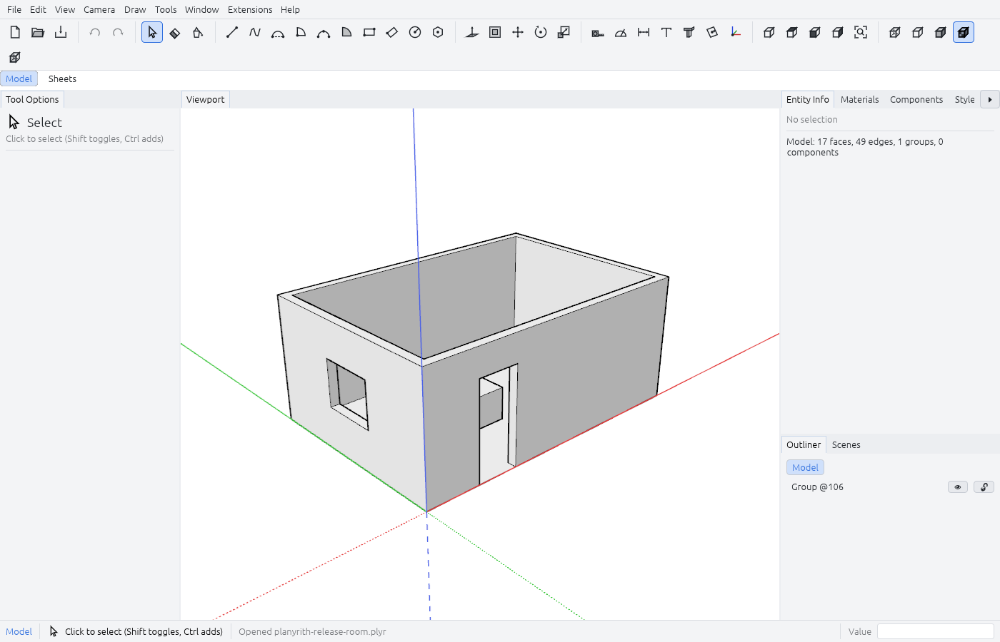
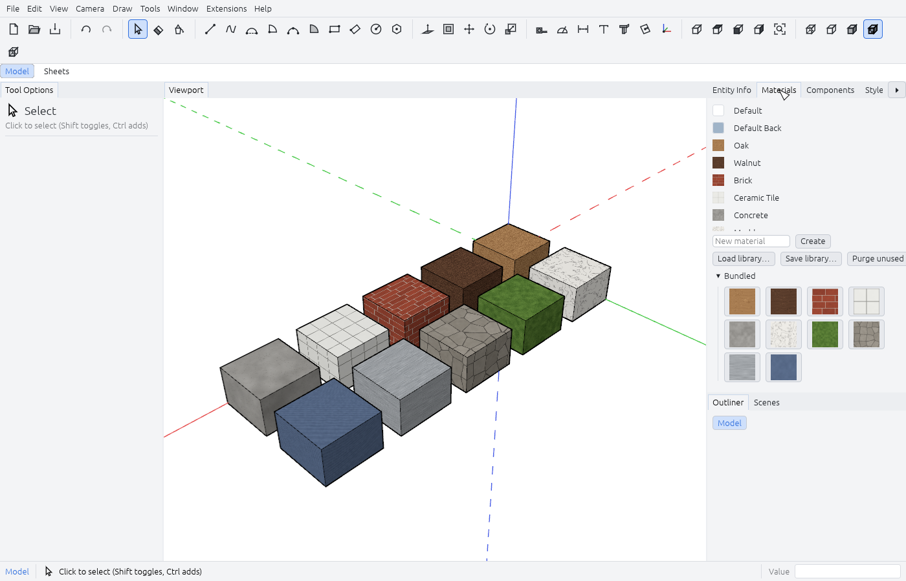
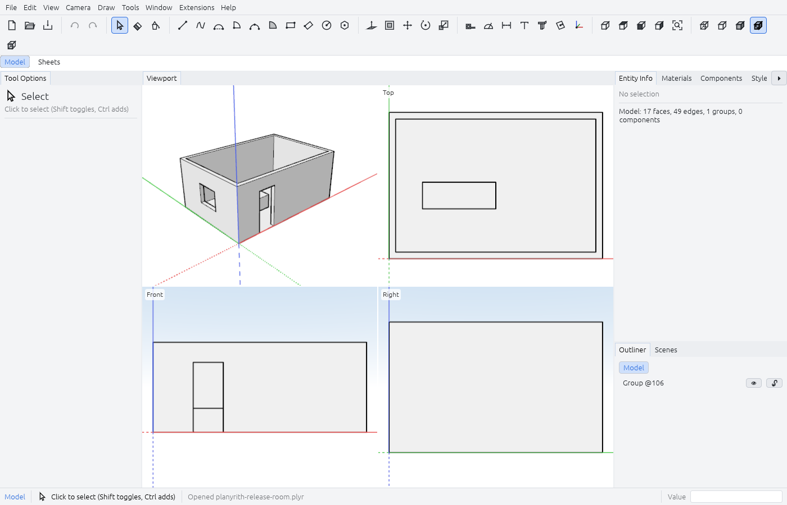

<p align="center">
  <picture>
    <source media="(prefers-color-scheme: dark)" srcset="assets/brand/logo-dark.svg">
    
  </picture>
</p>

<h1 align="center">Planyrith</h1>

<p align="center"><b>Precise 3D modeling, drawings and automation.</b></p>

<p align="center">
  Draw edges and faces, shape solids, organize reusable components and turn a model into scaled drawings.
  Work in the desktop GUI or run the same tools through the CLI, scripts and JSON-RPC.
  Written in Rust. Your native working format is <code>.plyr</code>.
</p>

<p align="center">
  <a href="https://github.com/KvasFan/Planyrith/actions/workflows/ci.yml"></a>
  
  
  <a href="#license-and-credits"></a>
  <a href="https://github.com/KvasFan/Planyrith/releases/tag/v0.11.0-alpha.2"></a>
</p>

<p align="center">
  <picture>
    <source media="(prefers-color-scheme: dark)" srcset="docs/images/modeling-dark.png">
    
  </picture>
  <br>
  <sub>A room made with Planyrith's own modeling acceptance scenario. Light and dark themes.</sub>
</p>

<p align="center">
  <a href="#downloads">Downloads</a> ·
  <a href="#screenshots">Screenshots</a> ·
  <a href="#what-works-today">What works today</a> ·
  <a href="#quick-start">Quick start</a> ·
  <a href="#skp-and-skb-models">SKP / SKB</a> ·
  <a href="#build-from-source">Build from source</a> ·
  <a href="#roadmap">Roadmap</a> ·
  <a href="#license-and-credits">License and credits</a>
</p>

## Downloads

**[0.11.0-alpha.2 — desktop preview](https://github.com/KvasFan/Planyrith/releases/tag/v0.11.0-alpha.2)**

| Platform | Download | Start |
|---|---|---|
| Windows 10/11, x64 | [Installer `.exe`](https://github.com/KvasFan/Planyrith/releases/download/v0.11.0-alpha.2/Planyrith-0.11.0-alpha.2-windows-x86_64-setup.exe) | Per-user installation with shortcuts and native file association. |
| Windows, portable x64 | [Portable `.zip`](https://github.com/KvasFan/Planyrith/releases/download/v0.11.0-alpha.2/planyrith-0.11.0-alpha.2-windows-x86_64-portable.zip) | Extract and run `planyrith-gui.exe`. |
| Linux, x86_64 | [AppImage](https://github.com/KvasFan/Planyrith/releases/download/v0.11.0-alpha.2/Planyrith-0.11.0-alpha.2-x86_64.AppImage) | Make executable and run. |
| Debian 12 / Ubuntu 22.04+, amd64 | [Debian package `.deb`](https://github.com/KvasFan/Planyrith/releases/download/v0.11.0-alpha.2/planyrith_0.11.0-alpha.2_amd64.deb) | `sudo apt install ./planyrith_*.deb` |
| Arch Linux, x86_64 | [Arch package `.pkg.tar.zst`](https://github.com/KvasFan/Planyrith/releases/download/v0.11.0-alpha.2/planyrith-0.11.0alpha2-1-x86_64.pkg.tar.zst) | `sudo pacman -U ./planyrith-*.pkg.tar.zst` |
| Arch / Linux, portable x86_64 | [Executable bundle `.tar.gz`](https://github.com/KvasFan/Planyrith/releases/download/v0.11.0-alpha.2/planyrith-0.11.0-alpha.2-linux-x86_64.tar.gz) | Extract and run `./Planyrith`. |

Packages include the GUI, CLI and separate SKP/SKB module, with license notices.
Windows setup lets you deselect the GPL format module. The installer is unsigned.
Linux binaries require glibc 2.35+ and a working Vulkan driver. Wayland and X11 are supported.
See [installation details](packaging/INSTALL.md), [checksums and complete sources](https://github.com/KvasFan/Planyrith/releases/tag/v0.11.0-alpha.2).
macOS and the browser edition can be built from source.

## Screenshots

<table>
  <tr>
    <td width="50%"><br><sub>Bundled materials, textures and the Materials panel.</sub></td>
    <td width="50%"><br><sub>Four views of the same editable model.</sub></td>
  </tr>
</table>

## What works today

- **Direct modeling.** Lines, rectangles, circles, arcs, freehand, Push/Pull,
  offsets, transforms, solids, Sweep, intersections and softened edges.
- **Precise placement.** Endpoint, midpoint, intersection, axis and plane
  inference; axis locking and exact value entry. Geometry uses millimeters internally.
- **Reusable models.** Groups, shared components, tags, materials, scenes,
  section cuts, guides, text and associative dimensions, with undo/redo.
- **Drawings.** Paper-space Sheets with scaled model views, annotations, tables
  and title blocks; multi-page PDF and SVG/DXF output.
- **Interchange.** SKP/SKB on desktop, OBJ, STL, glTF/GLB, DXF, STEP, images and
  CSV, plus the native `.plyr` container. Conversion limits are reported.
- **Automation.** Every modeling tool is a typed core command. The GUI,
  CLI, JSON-RPC server, Rhai scripts and declarative extensions share those commands.
- **Recovery.** Autosaves, crash recovery and native working copies preserve the
  full document. Whole-model external sources remain available in `.plyr` copies.

## Quick start

Start **Planyrith**, draw a rectangle, use Push/Pull to give it height and save
your model as `.plyr`. Open the included examples to explore the tools.
Use the **Model / Sheets** tabs to switch between modeling and paper layouts.

The CLI is included beside the GUI:

```sh
planyrith new -o design.plyr
planyrith -f design.plyr tool rectangle --corner-a 0,0,0 --corner-b 1000,1000,0
planyrith -f design.plyr tool push-pull --face '{face}' --distance 1000mm
planyrith -f design.plyr validate
```

Use `planyrith tool` to list modeling commands and `planyrith tool <name> --help`
for parameters and units. Scripts use millimeters and radians. On portable Linux
or AppImage, `./Planyrith --cli …` or `./Planyrith-….AppImage --cli …` selects the CLI.
The [CLI specification](docs/08-cli-specification.md) covers scripting and RPC.

## SKP and SKB models

Open or import `.skp` and `.skb` directly on desktop. Historical reading starts
at 2013; fixtures cover 2013–2017, 2019/2020 and 2026, with additional modern-family
probes. **Complete per-release fidelity remains in progress**, particularly for
uncertified releases and some appearance/entity details.

The first save proposes **`.plyr`**, preserving your input. Choose an explicit
SKP/SKB destination in **Save As** to write that format. Unchanged whole-model
sources restore byte for byte, including their original version. After edits,
the current writers target **2017 or 2026**; edited 2013–2016 writing is not yet
implemented. The original remains in the native working copy.

The optional format module runs as a separate GPL-3.0-only process; the GUI calls
it automatically. Keep it beside the application. The browser currently cannot
run this module. See [scope and licenses](crates/planyrith-skp/README.md) and the
[compatibility worklist](docs/dev/skp-fidelity.md).

## Build from source

```sh
git clone https://github.com/KvasFan/Planyrith.git
cd Planyrith
cargo build --workspace --release --locked --features planyrith-cli/render
./target/release/planyrith-gui
```

The stable Rust toolchain is pinned by `rust-toolchain.toml`; the current MSRV is
1.95. `--workspace` also builds the separate format module. Default application
members remain independent of GPL code. Use `cargo test --workspace` for the
test suite. [Packaging instructions](docs/16-release-and-packaging.md) describe
`cargo xtask`, installer validation and release publication.

## Architecture

| Component | Responsibility |
|---|---|
| [`planyrith-core`](crates/planyrith-core) | Deterministic document model, geometry, typed commands and file I/O. |
| [`planyrith-render`](crates/planyrith-render) | Shared `wgpu` viewport and headless rendering. |
| [`planyrith-cli`](crates/planyrith-cli) | CLI, scripting, extensions and JSON-RPC. |
| [`planyrith-gui`](crates/planyrith-gui) | Desktop and browser interface over the same command registry. |
| [`planyrith-skp`](crates/planyrith-skp) | Optional, separate GPL format process. |
| [`xtask`](xtask) / [`packaging`](packaging) | Release payloads, licenses and installers. |

## Roadmap

The modeling kernel, desktop/browser interfaces, organization, interchange,
automation, solids and Sheets milestones are implemented. The current preview
focuses on historical-model compatibility and native working copies; full SKP
fidelity and independent reader certification remain open. Stabilization and
broader installation testing follow. See [the roadmap](docs/13-roadmap.md),
[changes](CHANGELOG.md) and [project specification](docs/00-overview.md).

## License and credits

The applications are dual-licensed under [MIT](LICENSE-MIT) or
[Apache-2.0](LICENSE-APACHE). The optional `planyrith-skp` executable and its
`openskp` dependency are [GPL-3.0-only](crates/planyrith-skp/LICENSE) and are never
linked into the applications. The classic reader retains its
[MIT reference attribution](crates/planyrith-skp/tests/fixtures/intermediate/LICENSE).
Inter font notices and dependency licenses accompany the packages. AppImage
deployment-runtime notices and corresponding sources accompany that distribution.
Logo, interface images and example geometry shown here are project-made.

Dependency policy is recorded in [docs/02](docs/02-technology-stack.md) and checked
by `cargo deny`. Contributor instructions are in [AGENTS.md](AGENTS.md).
