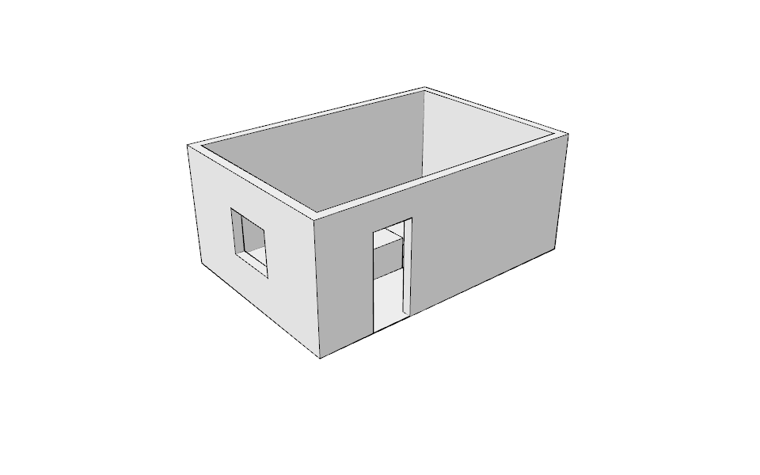

# QA script — model a room in 10 steps

**Audience:** testers before a release (docs/12 §7). Milestone 0.3 acceptance (docs/13): the
script completes with mouse and keyboard only, and typed lengths are exact.

**Automated twin:** `crates/planyrith-gui/src/app.rs`, test `qa_model_a_room_in_ten_steps`,
runs the same steps with synthetic input on every `cargo test`. To regenerate the expected
screenshot:

```sh
PLANYRITH_QA_OUT=/tmp/room.plyr cargo test -p planyrith-gui qa_model_a_room
planyrith render -f /tmp/room.plyr --width 960 --height 600 \
  --camera 'eye=-6000,-9000,8000;target=3000,2000,600' docs/qa/model-a-room.png
```

## Setup

Start `planyrith-gui` with no file (an empty model in millimeters). Orbit (middle-drag) and zoom
(wheel) so that the ground near the origin and a 6 × 5 m area in front of it are visible, with
the camera above the ground looking down at about 40°. Values are typed without clicking into the
value field; `Enter` applies them.

## Steps

| # | Do | Expect |
|---|---|---|
| 1 | `R` (Rectangle). Click on the ground near the origin, move toward +X/+Y, type `6400,4400`, `Enter`. | A 6400 × 4400 face on the ground. |
| 2 | `F` (Offset). Click the face, move the cursor inside it, type `200`, `Enter`. | An inner face and a 200 mm ring. |
| 3 | `P` (Push/Pull). Click the ring, move up, type `2700`, `Enter`. | Walls 2700 high and 200 thick. A preview follows the cursor before `Enter`. |
| 4 | `R`. Click the bottom edge of the front wall's outer face about 1.2 m from its left corner (the On Edge mark shows); move up and right over the wall; type `900,2100`, `Enter`. | A 900 × 2100 rectangle on the wall, standing on the ground. |
| 5 | `P`. Click the door rectangle, move into the wall, type `200`, `Enter`. | The door is an opening through the wall. |
| 6 | `R`. On the outer face of the left wall, click about 1.6 m from the front corner and 0.9 m up; move up and away; type `1200,1000`, `Enter`. | A 1200 × 1000 rectangle on the wall. |
| 7 | `P`. Click the window rectangle, move into the wall, type `200`, `Enter`. | The window is an opening through the wall. |
| 8 | `R`. Click on the ground in front of the room, move toward +X/+Y, type `2200,800`, `Enter`. | The table's footprint. |
| 9 | `P`. Click the footprint, move up, type `720`, `Enter`. | A 720 high block. |
| 10 | `Space` (Select). Triple-click the block, then Edit › Make Group. `M` (Move): click a top corner of the block, type `<0,4500,0>`, `Enter`. | The table group stands inside the room. |

After any step, typing a new value and `Enter` before the next click replaces that step's value
(for example `2500` after step 3 makes the walls 2500 high), and `Ctrl+Z` undoes the step.

## Expected result



- File › Save writes the model; reopening it shows the same room.
- The status bar showed no error during the script; `planyrith validate` on the saved file
  reports no problem.
